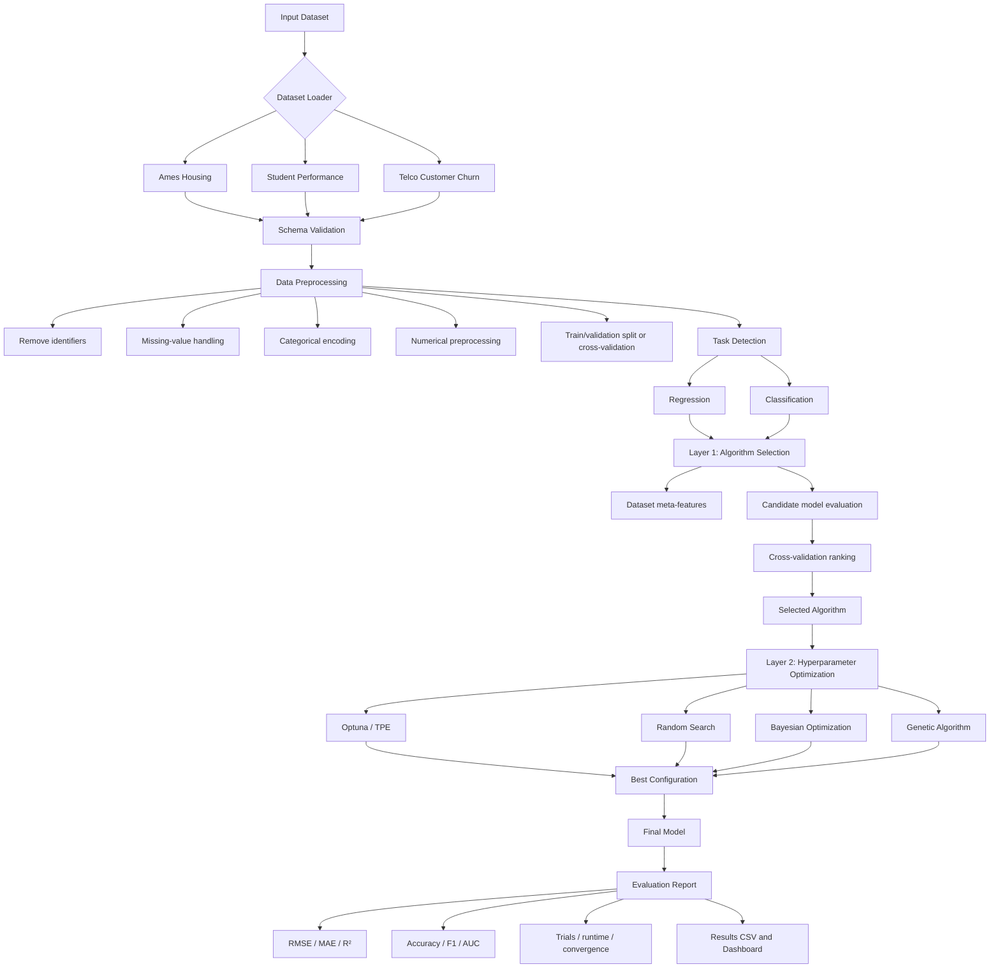

# Automated Regression and Classification Optimization Platform

## 1. System architecture



## 2. Two-layer research design

| Layer | Research question | Input | Process | Output |
|---|---|---|---|---|
| Data layer | Can the dataset be prepared consistently? | Raw CSV | Load, validate, clean, encode, split | Model-ready features and target |
| Layer 1: Algorithm Selection | Which model family suits this dataset and task? | Prepared dataset | Evaluate candidate algorithms with cross-validation | Selected algorithm and evidence |
| Layer 2: Hyperparameter Optimization | Which parameter configuration performs best? | Selected algorithm and search space | TPE, random, Bayesian, or genetic search | Best configuration |
| Final modeling | How well does the optimized model generalize? | Best configuration | Fit final model on training data | Predictions |
| Evaluation | How effective and efficient is the platform? | Predictions and experiment log | Calculate metrics, runtime, trials, and convergence | Reproducible report |

## 3. Current implementation map

| Project file | Responsibility | Current output |
|---|---|---|
| `preprocess.py` | Ames data loading and leakage-safe preprocessing | Transformed train/validation shapes |
| `baseline.py` | Ames baseline comparison | `baseline_results.csv` |
| `student_data.py` | Student dataset loading and inspection | Dataset characteristics |
| `student_selection.py` | Student Layer 1 algorithm selection | `student_algorithm_selection_results.csv` |
| `student_optimization.py` | Student Stage 4 Optuna/TPE optimization | `student_optimization_results.csv` |
| `churn_data.py` | Telco data cleaning and inspection | Churn distribution and schema |
| `requirements.txt` | Runtime dependencies | Reproducible environment |

## 4. Dataset and task matrix

| Benchmark | Task | Target | Candidate algorithms | Primary metrics |
|---|---|---|---|---|
| Ames Housing | Regression | `SalePrice` | Ridge, Random Forest, XGBoost, LightGBM | RMSE, log-RMSE, MAE, R² |
| Student Performance | Regression | `G3` | Linear Regression, Random Forest, SVR, XGBoost, LightGBM | RMSE, MAE, R² |
| Student Performance | Classification | `G3 >= 10` | Logistic Regression, Random Forest, SVM, XGBoost, LightGBM | Accuracy, F1, ROC-AUC |
| Telco Customer Churn | Classification | `Churn` | Logistic Regression, Random Forest, SVM, XGBoost, LightGBM | Accuracy, F1, ROC-AUC |

## 5. Hyperparameter optimization record

| Field | Description |
|---|---|
| `algorithm` | Model family selected by Layer 1 |
| `optimizer` | TPE, random search, Bayesian optimization, or genetic algorithm |
| `best_configuration` | Parameter values found by the optimizer |
| `best_objective_value` | Best cross-validation objective |
| `rmse` / `mae` / `r2` | Regression evaluation metrics |
| `accuracy` / `f1` / `roc_auc` | Classification evaluation metrics |
| `number_of_trials` | Number of objective evaluations |
| `optimization_time_seconds` | Time spent searching |
| `random_state` | Seed used for reproducibility |

## 6. Execution flow

```text
1. Load an official or explicitly provided dataset.
2. Validate the schema and identify the task and target.
3. Fit preprocessing only within training folds or on the training partition.
4. Evaluate candidate algorithms using a fixed cross-validation protocol.
5. Select the algorithm with the best primary metric.
6. Search the selected algorithm's hyperparameter space.
7. Fit the best configuration and evaluate on held-out data.
8. Save metrics, configuration, runtime, and trial history.
```

## 7. Reproducibility rules

- Keep preprocessing inside a scikit-learn `Pipeline`.
- Never fit imputers, encoders, or scalers on validation/test data.
- Use fixed random seeds for data splits and stochastic algorithms.
- Compare optimizers using the same budget and validation protocol.
- Record both predictive quality and computational cost.
